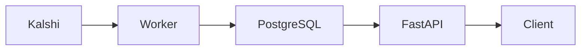

# Architecture

The worker collects Kalshi market data and writes to PostgreSQL. FastAPI reads
stored observations. API requests do not fetch from Kalshi, so previously saved
data remains available when collection fails.

## Quote normalization

Kalshi order books contain YES and NO bids. The normalized YES quote uses:

- Bid: the highest YES bid, with its quantity.
- Ask: `1 - highest NO bid`, with the quantity at that NO bid.
- Spread: ask minus bid, when both sides exist.

Prices use Python `Decimal` and PostgreSQL `NUMERIC`. The adapter accepts up to
four decimal places for prices and two for quantities; unsupported precision
is rejected without rounding. JSON responses represent these values as strings.

An empty side produces null price and quantity. Missing required fields or
malformed levels reject the observation. Zero-quantity levels are ignored.
Crossed quotes retain the observed values and negative spread, with
`is_crossed: true`.

## Storage

| Table | Contents |
| --- | --- |
| `markets` | Exchange ticker, title, status, and close time |
| `snapshots` | Market/run references, collection slot, timestamps, prices, and quantities |
| `ingestion_runs` | Configuration, outcomes, attempt counts, timing, and status |
| `alert_rules` | Market, decimal threshold, enabled/alerted state, and last delivery time |

Markets are unique by `(platform, external_id)`. Snapshots are unique by
`(market_id, collection_slot)`. Insertion uses `ON CONFLICT DO NOTHING`, keeping
the first valid observation for a slot even when requests compete. An unchanged
price in a later slot is a new observation.

Each market's metadata and snapshot commit in one transaction. Worker writes
also commit the market's run outcome in that transaction. A failed market does
not roll back another market's data. Replays retain the original snapshot and
its originating run.

The `(market_id, observed_at, id)` index supports latest and chronological
history queries. It also adds storage and write maintenance. Offset pagination
is simple at this scale; deeper offsets cost more and concurrent inserts can
shift pages.

## Collection and failure handling

One sequential worker reads a JSON watchlist of 1–10 tickers. The default
interval is 60 seconds. Inactive markets receive metadata updates without book
polling; their history remains queryable.

Three times have distinct meanings:

- `collection_slot`: the scheduled UTC interval shared by the cycle.
- `observed_at`: when the order-book response was received.
- `source_timestamp`: an exchange observation timestamp, null when unavailable.

Retries keep the same slot. After downtime or an overrun, collection resumes in
the current slot and leaves missed intervals empty.

Temporary transport errors, HTTP 429, and HTTP 500/502/503/504 get at most three
attempts per request. Backoff uses exponential full jitter. Valid `Retry-After`
instructions take precedence; a delay that cannot fit stops further requests
for the cycle. Permanent errors and malformed responses are not retried.

The default cycle allowance is `min(50 seconds, 80% of the interval)`, or 48
seconds at the default interval. Retry waiting has a separate 10-second limit.
Budget checks gate new requests and waits; they cannot forcibly cancel a
synchronous request or database transaction already in progress.

Run reports distinguish inserted, duplicate, fetch, validation, storage, and
unattempted outcomes. Inserted counts come from committed rows. Unfinished runs
are reported as incomplete; unknown outcomes are preserved. SIGINT/SIGTERM stop
new requests and wake scheduler waits while allowing in-flight work to finish.

## API behavior

Local/private alert routes create, list, and disable rules. An enabled rule sends
to Discord when a newly committed snapshot's YES ask is below its threshold and
the rule has not alerted. An ask at or above the threshold rearms it. Alert state
commits separately from ingestion; failed notification or state writes cannot
undo a snapshot or change its ingestion outcome. The single worker delivers
synchronously after finishing the cycle's collection, with a five-second HTTP
timeout and no immediate retries. Delivery cannot consume another market's
collection budget, but can delay the next cycle.
Delivery is best effort: a send followed by a failed state commit can produce a
duplicate on a later snapshot. See the README for configuration and API commands.

Latest quotes are selected by `(observed_at DESC, id DESC)`. Collection age is
measured from `observed_at`. An observation is stale when its age exceeds the
configured threshold, default 120 seconds. Negative age indicates clock skew
and is treated as stale.

Liquidity status, exchange market status, and freshness are separate fields.
Unknown markets return 404. Known markets without snapshots return 200 with
`status: "no_observations"` and null quote, age, and stale flag. An empty book
is a valid observation and differs from having no observations.

History defaults to the last 24 hours, accepts a maximum seven-day range, and
returns at most 1,000 observations per page. Timestamps must include a timezone
and are normalized to UTC. Ranges include start and exclude end; results are
ordered by `(observed_at, id)`. A requested page can be empty even when the
market has observations elsewhere.

The dashboard at `/dashboard` is one static HTML file. It calls the same JSON
routes from the browser, refreshes every 30 seconds, and needs no database
access of its own. Chart lines break where collection missed slots or a book
side was empty. CSV downloads keep the API's exact decimal strings.

Each overview/history request has an incrementing identifier. Only the most recent
request can update its view. Changing markets or time ranges clears old history;
CSV export stays disabled until the current request succeeds. Failed history
loads show an error instead of retaining another selection's observations.
Browser HTTP requests time out after 10 seconds.

## Runtime and verification

Compose starts PostgreSQL, waits for readiness, applies Alembic migrations,
then starts the API and one worker. The database uses a named volume. API and
database ports bind to localhost. The API never starts a collector itself.

Unit tests use mocked exchange and Discord HTTP; integration tests use an isolated
PostgreSQL database whose name ends in `_test`. The container persistence check
saves a labeled synthetic quote and verifies its values and IDs after removing
and recreating containers. Live collection is checked separately.

Verification includes 324 Python tests, eight JavaScript regression tests, and
Chrome checks for charts, exports, and request ordering. Local Docker checks
verify startup and persistence. Three live cycles across five markets saved
15 snapshots. Both synthetic test data and live history survived container
recreation. GitHub Actions repeats the automated tests and container checks.
